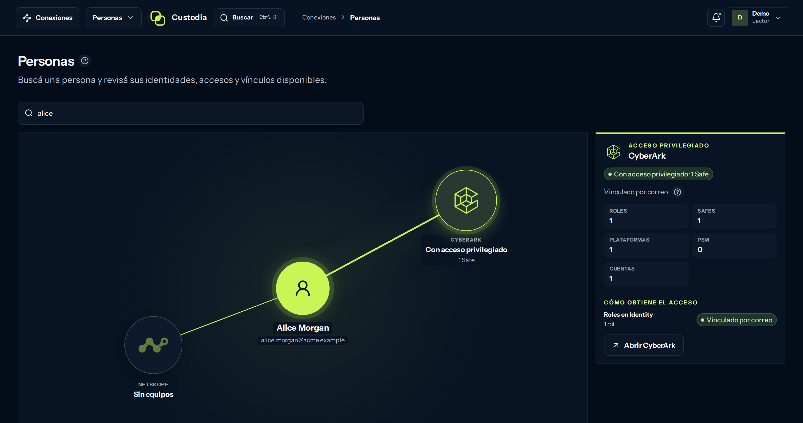

<p align="center">
  
</p>

<h1 align="center">Custodia</h1>

<p align="center">
  <strong>Lo que tus herramientas de seguridad saben, juntas.</strong><br>
  Custodia une con reglas explícitas los registros de las herramientas de seguridad que ya usás y muestra lo que ninguna ve sola. Cada conclusión lleva su regla, su fuente y su captura.
</p>

<p align="center">
  <a href="https://custodia-demo.pages.dev/?lang=es">Demo en vivo</a> ·
  <a href="https://custodia.octaviosantacruz.com/es/">Sitio</a> ·
  <a href="#cómo-funciona">Cómo funciona</a> ·
  <a href="#estado-y-hoja-de-ruta">Hoja de ruta</a> ·
  <a href="docs/PRODUCT.md">Producto</a> ·
  <a href="LICENSE">Apache 2.0</a>
</p>

<p align="center"><a href="README.md">English</a> · <strong>Español</strong></p>

> **Prototipo:** la interfaz está completa y corre como demo con datos ficticios. El backend Go y los adaptadores reales están en curso.



*La demo con una empresa ficticia: cómo se une una persona en cada herramienta y el veredicto con su evidencia.*

## El problema

Cada consola responde su propia pregunta. El PAM sabe quién tiene cuentas
privilegiadas. El proxy SSE sabe qué equipos reportan. El proveedor de
identidad sabe quién existe. Nadie es dueño de la respuesta *entre* ellas, así
que vive en planillas que quedan viejas el mismo día y se cruzan por nombre,
sin que nadie pueda auditarlo.

Custodia reemplaza esa planilla por un inventario que recuerda de dónde salió
cada dato y se niega a adivinar.

## Preguntas que responde

| Pregunta | Qué dice Custodia | Veredicto |
|---|---|---|
| ¿Quién tiene acceso privilegiado sin un equipo visible? | Alice está en un Safe de CyberArk con una cuenta de servicio; Netskope ve su usuario, pero ningún equipo en una captura completa. | **Brecha** |
| ¿De quién dejaron de reportar los equipos? | Uno de los dos equipos de Bob lleva 12 días en silencio. No prueba que se haya dado de baja, así que la cobertura queda parcial. | **Parcial** |
| ¿Qué identidad es esta persona? | Dos registros activos de identidad comparten el correo de Eve. Custodia no une ninguno y espera que una persona elija. | **Desconocido** |
| ¿Qué dice realmente cada herramienta? | Cada registro tal como lo entregó la herramienta, con su ID de origen y su corrida, y el vínculo propuesto aparte. | Registros crudos |

Las cuatro están en la demo, con una empresa ficticia (Acme Corp).

## Cómo funciona

1. **Recolectar.** Adaptadores de sólo lectura por herramienta. Cada registro
   conserva su ID de origen, la corrida que lo trajo y su antigüedad.
2. **Unir.** Un vínculo necesita una coincidencia exacta y única. Dos
   candidatos significan ningún vínculo y una decisión humana, nunca una
   moneda al aire.
3. **Concluir.** Reglas versionadas convierten los registros unidos en
   veredictos con su evidencia: cubierto, parcial, brecha o desconocido.

## Principios de diseño

- **Procedencia en todo.** Cada dato nombra su fuente, ID externo, fecha y
  corrida.
- **Desconocido no es brecha.** Una captura parcial o fallida da
  «desconocido», nunca una falsa alarma. Ausencia, falta de permiso y cero
  observado son estados distintos.
- **Sin adivinanzas silenciosas.** Nombres parecidos nunca convierten dos
  registros en una identidad.
- **Las personas deciden; la sincronización no pisa.** Lo observado por las
  herramientas y lo decidido por el equipo son capas separadas.
- **Sólo lectura.** Custodia consulta tus herramientas; no las modifica.

## Para quién es

Operadores de seguridad e infraestructura que manejan varias consolas y
responden a mano las mismas preguntas de inventario: revisiones de acceso,
chequeos de cobertura, bajas y auditorías.

## Fuentes

| Hoy, en la demo | Después |
|---|---|
| CyberArk PAM (Safes, cuentas, miembros) · Netskope SSE (usuarios, equipos, postura) | BigID, CrowdStrike, Cortex XDR, Tenable, firewalls |

Cada fuente nueva llega con su contrato y sus reglas; el núcleo no está atado a
estos dos fabricantes.

## Estado y hoja de ruta

Custodia es un prototipo honesto. La interfaz está completa; el backend,
todavía no.

| Etapa | Qué | Estado |
|---|---|---|
| Demo | Personas cruzadas entre CyberArk y Netskope, veredictos con evidencia e inventario de cada herramienta, en español e inglés. Corre entera en el navegador. | Hecho |
| Backend | Go y PostgreSQL; las reglas existentes pasan con sus pruebas de regresión. | En curso |
| Autohospedado | Adaptadores reales de CyberArk y Netskope, ingreso por OIDC e instalación reproducible. | Siguiente |
| Más fuentes | Herramientas de datos, endpoint, vulnerabilidades y firewalls. | Después |

Una versión alojada (SaaS) sólo se evaluará después de un uso real y
recurrente de la instalación autohospedada.

## Probarlo

Lo más rápido es la [demo en vivo](https://custodia-demo.pages.dev/?lang=es):
sin registro y sin que nada salga de tu navegador. Para correrla localmente:

```bash
cd web
npm ci
npm run preview:demo   # http://127.0.0.1:4184
```

El idioma se cambia desde el menú de usuario o con `?lang=es` / `?lang=en`.

## Repositorio

| Ruta | Qué |
|---|---|
| `web/` | La app: React, Vite y TypeScript. Compila contra una API real o como demo estática con API simulada ([WEB.md](docs/WEB.md)). |
| `site/` | El sitio del producto (`npm run build:site`). |
| `docs/` | Producto, arquitectura, conectores, diseño y decisiones. |
| `demo/` | Un experimento reducido anterior; no es la demo vigente. |

## Desarrollo

```bash
npm run verify:web      # tipos, lint, estilos, unitarias, build de la demo y e2e de web/
npm run build:site      # sitio del producto
npm run verify          # documentos + modelos de empresa y experimento
```

Requiere Node.js 24 o superior. Las pruebas de navegador usan Playwright con
Chromium (`npx playwright install chromium`; librerías del sistema con
`npx playwright install-deps chromium`, con sudo).

La interfaz se escribe en español y se traduce al inglés: los textos se
envuelven como `t('Texto en español')` y el inglés vive en
`web/src/cross/i18n/en.ts`. `node scripts/i18n-report.mjs --missing` (en
`web/`) lista lo que falte traducir.

## Documentación

| Tema | Documento |
|---|---|
| Alcance y etapas | [Producto](docs/PRODUCT.md) |
| Empresa ficticia, sitio y demo | [WEB.md](docs/WEB.md) · [COMPANY-DEMO.md](docs/COMPANY-DEMO.md) |
| Go y PostgreSQL | [Arquitectura](docs/ARCHITECTURE.md) |
| Configurar y sincronizar herramientas | [Conectores](docs/CONNECTORS.md) |
| Ingreso, OIDC y QA | [Acceso](docs/ACCESS.md) |
| Interfaz y recorrido de ejemplo | [Diseño](docs/DESIGN.md) |
| Criterios para avanzar | [Validación](docs/VALIDATION.md) |
| De dónde viene lo que lleva la demo | [Procedencia](docs/PROVENANCE.md) |
| Capturas y textos ES/EN | [Presentación](docs/PRESENTATION.md) |
| Decisiones aceptadas | [Decisiones](docs/DECISIONS.md) |
| Versión anterior, qué se aprovechó y qué se retiró | [Referencia](docs/REFERENCE.md) |
| Pendientes y evidencia entregada | [Pendientes](docs/TO_IMPLEMENT.md) · [Cierres](docs/IMPLEMENTED.md) |

## Licencia y marcas

Custodia nació como herramienta interna (DS Hub) y hoy es open source con
licencia [Apache 2.0](LICENSE). CyberArk, Netskope y los demás nombres de
producto son marcas de sus dueños e identifican las herramientas que Custodia
lee; Custodia no está afiliado a ellos.
