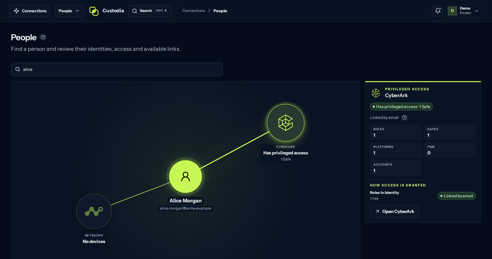

<p align="center">
  
</p>

<h1 align="center">Custodia</h1>

<p align="center">
  <strong>What your security tools know, together.</strong><br>
  Custodia joins the records of the security tools you already run with explicit rules, and shows what none of them sees alone. Every conclusion carries its rule, its source and its capture.
</p>

<p align="center">
  <a href="https://custodia-demo.pages.dev/?lang=en">Live demo</a> ·
  <a href="https://custodia.octaviosantacruz.com">Website</a> ·
  <a href="#how-it-works">How it works</a> ·
  <a href="#status-and-roadmap">Roadmap</a> ·
  <a href="docs/PRODUCT.md">Product</a> ·
  <a href="LICENSE">Apache 2.0</a>
</p>

<p align="center"><strong>English</strong> · <a href="README.es.md">Español</a></p>

> **Prototype:** the interface is complete and runs as a demo with fictional data. The Go backend and real adapters are in progress.



*The demo running on a fictional company: how one person is joined in each tool, and the verdict with its evidence.*

## The problem

Each console answers its own question. The PAM vault knows who holds
privileged accounts. The SSE proxy knows which devices report. The identity
provider knows who exists. Nobody owns the answer *across* them, so it lives
in spreadsheets that are stale the day they are built, joined by name
matching nobody can audit.

Custodia replaces that spreadsheet with an inventory that remembers where
every fact came from and refuses to guess.

## Questions it answers

| Question | What Custodia says | Verdict |
|---|---|---|
| Who has privileged access but no device we can see? | Alice is in a CyberArk Safe with a service account; Netskope sees her user but no device in a complete capture. | **Gap** |
| Whose devices stopped reporting? | One of Bob's two devices has been silent for 12 days. That is not proof it was retired, so coverage stays partial. | **Partial** |
| Which identity is this person? | Two active identity records share Eve's email. Custodia joins neither and waits for a person to choose. | **Unknown** |
| What does each tool actually say? | Every record as the tool delivered it, with its source ID and run, and the proposed link kept apart. | Raw records |

All four are in the demo, with a fictional company (Acme Corp).

## How it works

1. **Collect.** Read-only adapters per tool. Every record keeps its source
   ID, the run that brought it and how fresh it is.
2. **Join.** A link needs one exact, unique match. Two candidates means no
   link and a decision for a human, never a coin toss.
3. **Conclude.** Versioned rules turn joined records into verdicts with their
   evidence: covered, partial, gap or unknown.

## Design principles

- **Provenance on everything.** Each fact names its source, external ID,
  date and run.
- **Unknown is not a gap.** A partial or failed capture yields "unknown",
  never a false alarm. Absence, missing permission and zero observed are
  different states.
- **No silent guesses.** Similar names never merge two records into one
  identity.
- **Humans decide, syncs don't overwrite.** Observations from tools and
  decisions from people are separate layers.
- **Read-only by design.** Custodia queries your tools; it does not change
  them.

## Who it is for

Security and infrastructure operators who juggle several consoles and keep
answering the same inventory questions by hand: access reviews, coverage
checks, offboarding, audits.

## Sources

| Today, in the demo | Next |
|---|---|
| CyberArk PAM (Safes, accounts, members) · Netskope SSE (users, devices, posture) | BigID, CrowdStrike, Cortex XDR, Tenable, firewalls |

Each new source arrives with its own contract and its own rules; the core is
not tied to these two vendors.

## Status and roadmap

Custodia is an honest prototype. The interface is complete; the backend is
not.

| Stage | What | State |
|---|---|---|
| Demo | People crossed across CyberArk and Netskope, verdicts with evidence and each tool's inventory, in English and Spanish. Runs fully in the browser. | Done |
| Backend | Go and PostgreSQL. First path done: People and coverage (CONN-001) from the database, behind Ozal, with the same answers as the demo. Real connectors and roles are next. | In progress |
| Self-hosted | Real CyberArk and Netskope adapters, sign-in through OIDC, a reproducible install. | Next |
| More sources | Data, endpoint, vulnerability and firewall tools. | Later |

A hosted (SaaS) version will only be evaluated after real, recurring use of
the self-hosted install.

## Try it

The fastest way is the [live demo](https://custodia-demo.pages.dev/?lang=en):
no sign-up, nothing leaves your browser. To run it locally:

```bash
cd web
npm ci
npm run preview:demo   # http://127.0.0.1:4184
```

Switch language from the user menu or with `?lang=en` / `?lang=es`.

## Repository

| Path | What |
|---|---|
| `web/` | The app: React, Vite and TypeScript. Builds against a real API or as a static demo with a simulated API ([WEB.md](docs/WEB.md)). |
| `server/` | The Go backend with PostgreSQL. Today it serves People and coverage ([Architecture](docs/ARCHITECTURE.md)). |
| `site/` | The product site (`npm run build:site`). |
| `docs/` | Product, architecture, connectors, design and decisions (in Spanish). |
| `demo/` | An earlier, reduced experiment; not the current demo. |

## Server (in development)

`server/` serves the frontend and People from PostgreSQL. It has no login of its
own: it runs behind [Ozal](https://github.com/ozal-project/ozal), which signs an
identity assertion for each request that Custodia verifies with Ozal's public
key. Without one it answers 401, even on loopback.

```bash
cd web && npm ci && npm run build && cd ..           # frontend in real mode
cd server && go build -o custodia ./cmd/custodia
cp config.example.json custodia.json                 # issuer, Ozal's key, readers
export CUSTODIA_DATABASE_URL='postgres://…'
./custodia migrate up -config custodia.json
./custodia seed demo -config custodia.json -fixture ../web/src/demo/model/company.json
./custodia serve -config custodia.json                # 127.0.0.1:8090
```

In Ozal, Custodia's route sets `identity_assertion: {"audience": "custodia"}` and
`health_path: "/healthz"`; `sudo -u ozal ozal assertion public-key` prints the key for
`ozal.public_keys`.

## Development

```bash
npm run verify:server   # gofmt, vet and server tests (with a DB: eval "$(scripts/test-db.sh)")
npm run verify:web      # types, lint, styles, unit tests, demo build and e2e for web/
npm run build:site      # product site
npm run verify          # docs + company and experiment models
```

Requires Node.js 24 or later. Browser tests use Playwright with Chromium
(`npx playwright install chromium`).

The interface is written in Spanish and translated to English: texts are
wrapped as `t('Texto en español')` and English lives in
`web/src/cross/i18n/en.ts`. `node scripts/i18n-report.mjs --missing` (in
`web/`) lists anything untranslated.

## Documentation

The project documentation is written in Spanish.

| Topic | Document |
|---|---|
| Scope and stages | [Product](docs/PRODUCT.md) |
| Fictional company, site and demo | [WEB.md](docs/WEB.md) · [COMPANY-DEMO.md](docs/COMPANY-DEMO.md) |
| Go and PostgreSQL | [Architecture](docs/ARCHITECTURE.md) |
| Configuring and syncing tools | [Connectors](docs/CONNECTORS.md) |
| Sign-in, OIDC and QA | [Access](docs/ACCESS.md) |
| Interface and sample walkthrough | [Design](docs/DESIGN.md) |
| Criteria to move forward | [Validation](docs/VALIDATION.md) |
| Where the demo content comes from | [Provenance](docs/PROVENANCE.md) |
| Screenshots and ES/EN copy | [Presentation](docs/PRESENTATION.md) |
| Accepted decisions | [Decisions](docs/DECISIONS.md) |
| Previous version, what was reused and retired | [Reference](docs/REFERENCE.md) |
| Pending work and delivered evidence | [Pending](docs/TO_IMPLEMENT.md) · [Closed](docs/IMPLEMENTED.md) |

## License and trademarks

Custodia started as an internal tool (DS Hub) and is now open source under
the [Apache 2.0](LICENSE) license. CyberArk, Netskope and the other product
names are trademarks of their owners and identify the tools Custodia reads
from; Custodia is not affiliated with them.
