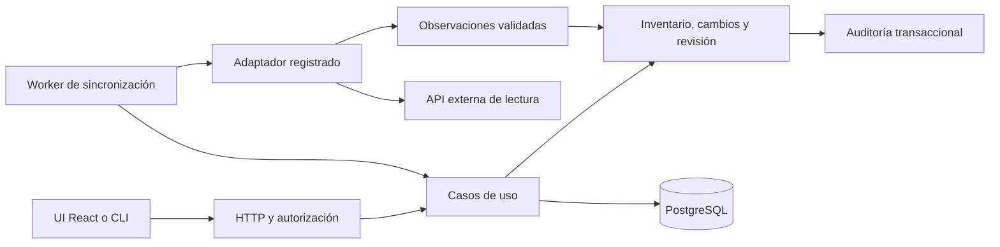

# Arquitectura del producto Go

**Estado (08/11):** primer recorrido implementado en `server/`: Personas y
cobertura (CONN-001) leídas de PostgreSQL, detrás de Ozal. El resto de este
documento sigue siendo el diseño objetivo; lo que ya existe está en
[Lo implementado](#lo-implementado).

**Corrección del dueño, 22/10:** la UI original y la lógica Python existente
definen la experiencia y los contratos que deben preservarse. Las carpetas y
modelos propuestos aquí se ajustan a esa paridad, sin convertir Safes,
Personas, cobertura y postura en una sola tabla genérica. Cruces e inferencias
son capacidad central; ver [revisión existente](EXISTING-PRODUCT.md).

## Límites y distribución

Un monolito modular, un backend Go y PostgreSQL como autoridad. Mantener
React/TypeScript/Vite y la experiencia existentes para la UI, preservando los
contratos HTTP durante la migración. El laboratorio debe usar fixtures de
esos contratos. Después, un mismo binario puede ofrecer comandos de servidor,
worker y migración, con procesos supervisados por separado cuando haga falta.
No introducir Redis, Kafka ni un servicio por proveedor para el primer flujo.

Propuesta de base técnica: `net/http` para HTTP; pgx/v5 y un pool acotado para
PostgreSQL; SQL explícito y Goose para migraciones nuevas. Seleccionar y fijar
versiones al crear el módulo, revisar licencias/advisories y demostrar
arranque/apagado y transacciones. No se instala una dependencia por este doc.
Referencias primarias: [HTTP de Go](https://pkg.go.dev/net/http),
[pgxpool](https://pkg.go.dev/github.com/jackc/pgx/v5/pgxpool),
[Goose](https://pressly.github.io/goose/).



Los conceptos puros no dependen de HTTP, SQL ni SDKs. Los casos de uso
definen interfaces pequeñas; adaptadores resuelven PostgreSQL, transporte y
proveedores. Una carpeta futura `server/` aloja Go; la v1 permanece en su
checkout de referencia y no forma parte de este árbol limpio.

Estructura objetivo, no rutas existentes:

```text
server/
  cmd/custodia/             composición, serve, worker, migrate
  internal/identity/       sesión y autorización
  internal/connections/    configuración y capacidades
  internal/inventory/      observaciones e identidad de registros
  internal/review/         responsable, estado y nota
  internal/sync/           ejecución, leases y completitud
  internal/audit/          eventos transaccionales
  internal/adapters/       PostgreSQL, HTTP y conectores explícitos
  migrations/              historia nueva de la base del producto
```

## Modelo mínimo

| Concepto | Responsabilidad |
|---|---|
| Tipo de conector | Código versionado: proveedor/herramienta, capacidades y contrato. |
| Conexión | Instancia configurada por el operador, alcance y referencias de secretos. Varias por tipo. |
| Colección | Familia que se sincroniza y reconcilia por separado. |
| Corrida/intento | Quién pidió, conexión, alcance/versiones, lease, progreso, errores y completitud por colección. |
| Observación | Clave externa, atributos permitidos, timestamps y corrida de procedencia. |
| Estado actual y cambios | Proyección verificable sobre observaciones; cambios explicados entre alcances comparables. |
| Revisión | Responsable, estado, nota y versión del cambio humano. Nunca payload externo. |
| Vínculo | Relación explícita con regla/origen/versionado y autorización en ambos extremos. No se requiere un grafo global. |

Identidad natural propuesta: **conexión + colección/tipo + ID externo**.
En PostgreSQL debe existir una restricción única coherente con esa identidad.
Un ID interno no implica que recursos de distintas conexiones sean iguales.
IDs externos son opacos; no usar nombres, correo o IP como claves universales.

Los campos consultados se tipan y validan; atributos específicos pueden usar
JSONB con allowlist y versión de esquema. No convertir todo en un documento
sin restricciones ni persistir payloads completos. Índices de conexión,
estado, paginación e historia se diseñan a partir de consultas reales; también
indexar claves foráneas usadas en joins. Tipos SQL y migraciones concretas se
cierran con el primer recorrido, no en esta revisión.

## Reglas de escritura y concurrencia

Una extracción larga escribe staging acotado; no mantiene una transacción
abierta mientras espera la red. El modelo de la demo permite actualizar lo
observado en una parcial, marcando su evidencia y cambios como parciales,
sin reemplazar la última línea base completa. Sólo un conjunto completo y de
alcance comparable respalda reconciliar ausentes como retirados. Este contrato
debe contrastarse con el flujo Python correspondiente antes de adoptarlo en
Go: el fixture reducido no gobierna toda la migración. Un cambio de filtro, credencial
o configuración crea una nueva generación; no elimina por comparación con
otro universo. Una colección completa puede avanzar sin retirar datos de una
colección incompleta de la misma conexión.

Claim de trabajo atómico, lease y fencing para rechazar al worker vencido;
exclusión de corridas incompatibles por conexión/colección. No basta un mutex
en memoria. Mantener el presupuesto total de conexiones de API, worker y
migrador bajo el límite de PostgreSQL. Los advisory locks requieren afinidad
de sesión cuando se usan a nivel sesión; una implementación transaccional
debe respetar su duración. [Bloqueos PostgreSQL](https://www.postgresql.org/docs/current/explicit-locking.html).

Repetir el mismo resultado no duplica recursos, cambios ni auditoría. El
commit del estado publicado y su auditoría es atómico. Las ediciones humanas
usan control de versión para no pisarse; el sync no toca sus campos.

## Acceso, secretos y operación

Separar autenticación y autorización según [el contrato de acceso](ACCESS.md).
Recomendar Switchboard para la instalación del dueño y OIDC genérico para
una instalación independiente, con un solo modo activo y sin fallback local.
La integración Switchboard necesita identidad verificable por la app; no está
implementada por tener un túnel o headers. OIDC implica cliente y sesión
revocable de Custodia, no crear un proveedor de identidad. Roles son plantillas sobre
permisos de acción y alcance de conexión, aplicados en backend a listados,
detalles, exportaciones, jobs y auditoría. Un total tampoco revela datos de
una conexión que el usuario no puede leer. Separar lectura sensible de
administración de la instalación, preservando la segregación de la v1.

Referencias de secreto por archivo/entorno protegido; nunca guardar valores
resueltos en JSON de conexión, respuestas, fixtures o historial. Configurar
una conexión requiere un operador autorizado; el conector no expone un proxy
HTTP arbitrario. Diagnóstico mediante códigos seguros, no cuerpos externos.

Migración explícita con rol separado; API/worker sólo validan revisión. La
instalación Go usa una base nueva y credenciales distintas de la v1. No hay
backfill ni acceso a datos laborales por defecto. Si después se solicita una
importación, necesita contrato de campos, permisos y aceptación propios.

## Cómo se prueba

Regresiones de dominio sin red; contrato de adaptadores contra un servidor
local; PostgreSQL descartable para transacciones, aislamiento, leasing y
concurrencia; UI contra fixtures y API real de prueba. Incluir dos conexiones
del mismo tipo con IDs externos iguales. Verificar instalación vacía,
upgrade y restore descartable antes del piloto externo. Una demo estática
no sustituye esas pruebas.

## Lo implementado

Módulo `server/` (Go 1.25 como mínimo). Dependencias fijadas: `pgx/v5` 5.12.0,
`goose/v3` 3.29.0 y `go-jose/v4` 4.1.9.

| Paquete | Rol |
|---|---|
| `cmd/custodia` | Composición: `serve`, `migrate up`, `seed demo`, `version`. `serve` se niega a arrancar con migraciones pendientes. |
| `internal/people` | Núcleo puro: personas desde Identity, vínculos por correo exacto y único, CONN-001 con su evidencia. |
| `internal/inventory` | Conexiones, corridas y observaciones; `Assemble` arma el snapshot; `AcmeSeed` carga la empresa ficticia. |
| `internal/identity` | Verifica la aserción de Ozal (firma con clave fijada, emisor, audiencia, vigencia ≤ 60 s, `jti` único) y exige par en loopback. |
| `internal/store/postgres` | Adaptador `pgx`; migraciones `goose` embebidas en `migrations/`. |
| `internal/httpapi` | Las rutas de Personas, `auth/status`, preferencias en memoria y el frontend compilado; lo demás responde 501. |

Identidad natural en la base: `(conexión, colección, id externo)`, con
`attrs` `jsonb` versionado. Personas y vínculos se calculan al leer; todavía no
se persisten. La paridad con la demo se prueba contra respuestas exportadas de
`web/src/demo/acme-api.ts` (`server/testdata/golden`, `server/scripts/export-golden.mjs`).
Las pruebas de PostgreSQL usan una base descartable en Docker (`scripts/test-db.sh`).

Límites de esta etapa: sin conectores ni sincronización (`PROD-CONN-001`), sin
roles (los lectores salen de `readers` en la configuración), preferencias de
vista en memoria, una conexión por fuente y caché de replay en memoria de una
sola instancia.
